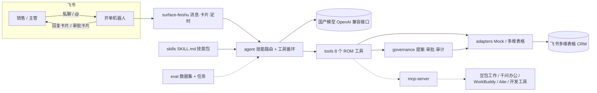

# 开单 Kaidan：中国版「Claudeforce」可行方案 v0.1

> 杭州境蓝人工智能科技有限公司 · 2026-09-18 · 内部决策用
> "开单 / Kaidan"是工作代号。对外品牌不要使用 Claude、Claudeforce 或 "-force"（分别是 Anthropic 与 Salesforce 的商标/品牌），上线前做商标检索。
> 本文事实部分来自公开资料（见文末来源），判断与数字假设是我方分析，已标注"待验证"的必须经客户访谈确认。

---

## 0. 一页结论

**Claudeforce 是什么。** 2026-08-26 Salesforce 与 Anthropic 在 Salesforce 二季度财报日宣布的扩大合作总称。第一个产品 "Salesforce in Claude" 是一个 Claude 插件：37 个销售技能 + Salesforce 连接器 + Slack 连接器，销售在 Claude 里完成晨报、会前准备、商机体检、会后更新 CRM、管道复盘；权限沿用 Salesforce 原有权限，写入默认要销售确认。2026-09-15 起在所有付费 Claude 套餐开放 beta。

**中国市场的真实情况：直接照搬的位置已经被占了。**
1. "中国的 Claude"已经出现：腾讯 WorkBuddy、阿里千问办公、字节豆包工作都在 2026 年上线了带连接器与技能的办公 Agent。
2. "中国的 Salesforce in Claude"也已经出现：纷享销客把 800+ 工具的 MCP 服务 + Skills 做成"纷享销客 CRM 连接器"，上架了上面三家平台。
3. 飞书自己的 CRM 方案（多维表格 + 豆包 AI）覆盖了轻量销售管理，字节还在 7 月底把飞书产品团队并入了豆包。

一个人的公司去做"通用 CRM 连接器"或"通用办公 Agent"没有胜算。

**可行的切口。** 不做 CRM，不做通用 Agent。做 Claudeforce 里真正难复制的那一层：**销售技能（方法论）+ 客户自己的 CRM 结构映射 + 写入治理 + 评测与交付**。先切大厂和 CRM 厂商都顾不上的细分：**已在用飞书、客户数据在多维表格（或 Excel）里的 10–100 人 B2B 销售团队**。产品是飞书里的主动式销售助手（晨报 / 会前 / 会后一句话更新 CRM / 商机体检 / 周报），同时把能力以 MCP server + SKILL.md 技能包输出，可装进豆包工作、千问办公、WorkBuddy 或 Aite。

**硬约束。** 运行时不能用 Claude（Anthropic 不支持中国地区，也禁止为不支持地区转接），只能用国产已备案模型；上线要关注网信办"登记"与模型公示；客户联系人属于个人信息，要最小化处理并签委托处理协议。

**节奏与止损。** 第 1 周用 Claude Code 并行搭 MVP（本仓库 T0 → T1–T4 → TΩ），同时启动 15–20 场客户访谈；**第 2 周末签不下 3 个付费试点就停止加码**，MVP 留作作品与演示。

---

## 1. Claudeforce 拆解

### 1.1 时间线

| 时间 | 事件 |
|---|---|
| 2025 年底 | Claude 已是 Agentforce 可选的底座模型（Claudeforce 是对既有合作的正式化与扩大） |
| 2026-04-15 | TDX 大会发布 Headless 360：平台能力全部以 API / MCP 工具 / CLI 形式开放给 Agent |
| 2026-07 | Salesforce Hosted MCP Server 进入 Beta |
| 2026-08-26 | 宣布 Claudeforce（与 Q2 FY27 财报同日），Salesforce in Claude 进入定向试点 |
| 2026-09-15 | Salesforce in Claude 在所有付费 Claude 套餐开放 beta；Salesforce 把它并入更大的 AIforce 发布 |

### 1.2 它由三块组成

- **Claude in Salesforce**：Atlas 推理引擎、Agent Builder 可选 Claude；Agentforce Vibes / Coworker 默认 Claude；推理经 Amazon Bedrock 跑在 Salesforce 信任边界内（这是受监管行业安全评审最关心的一句）。
- **Salesforce in Claude**：插件形态，37 个销售技能 + Salesforce 连接器 + Slack 连接器。
- **Claude in Slack**：Slackbot、Claude Tag、Slack Code 默认使用 Claude。

### 1.3 Salesforce in Claude 的五个核心工作流 → 开单对应

| 工作流 | Salesforce in Claude 做什么 | 开单 MVP 对应 |
|---|---|---|
| 每日简报 | 当天会议、即将成交、风险商机、待回复线程；可直接改成交日期/阶段/加任务；周五汇总并起草给经理的周报 | `/晨报`（工作日 08:30 私聊推送）+ `/周报`（周五 17:00） |
| 会前准备 | 汇总 CRM、Slack、邮件里的商机进展、团队讨论、未回复线程、遗留问题；发现 CRM 里没有的干系人就补为联系人 | `/会前`（MVP 读 CRM 与日程；新联系人走提案） |
| 商机体检与成交计划 | 按团队方法论打分，找资格缺口、没见过的干系人、成交日期风险；可继续起草商业论证与带日期的共同成交计划、补资格字段 | `/商机体检`（MVP：资格缺口 + 风险 + 下一步 + 补字段提案；成交计划放 P2） |
| 会后更新 | 把会议转写或笔记变成跟进邮件、群内摘要、商机字段更新草稿，销售审核后写入 | `/会后`（MVP：文字笔记 → 更新提案 + 跟进消息草稿；飞书妙记摄取放 P1） |
| 管道复盘与预测 | 交互式看板：各阶段覆盖、可能滑单及原因、按客户下钻，看板上直接改记录；按领导要求的格式起草预测说明 | `/周报` + `pipeline_snapshot`（MVP 用卡片；交互看板放 P2） |

### 1.4 架构上真正值得抄的七点

1. **小工具面。** Hosted MCP 只暴露 `discover` / `describe` / `dispatch` / `dispatch_readonly` 四个工具：模型先语义搜索操作、读规格、再调用，而不是把几百个 API 注册成工具塞满上下文。→ 开单 MVP 只有 8 个工具；P1 对接纷享 800+ 工具时用同样的"发现—描述—调用"模式。
2. **技能 ≠ 工具。** 裸 MCP 连接只给模型一堆操作；技能写的是方法论（哪个字段可信、"商机健康"在本团队意味着什么），这决定了团队内输出是否一致。→ 开单的核心资产是技能包。
3. **管理员连一次，全员按各自权限用。** 权限检查发生在 Salesforce 组织里，不在 Claude 里。→ 开单原则 1：权限在记录系统里执行。
4. **写入前审批。** 默认每一处修改都要销售确认。→ 开单更严格：模型只能提案，提交只发生在人点"同意"之后。
5. **首次使用的初始化技能。** 识别用户的工具与连接器，生成按角色定制的看板。→ 开单 `/初始化`：读多维表格结构，自动起草字段映射（这也是压低交付成本的关键）。
6. **生成式 UI。** 当场生成带实时数据与操作的 HTML 看板。→ 飞书卡片做不到，MVP 不做，P2 考虑用多维表格仪表盘或网页。
7. **两种身份模式的坑。** MCP 路径是按用户 OAuth，每次调用以本人身份执行；Claude Tag 的 Salesforce 连接则用 client credentials + 专用集成用户，凭证属于 Agent 而非个人——安全姿态完全不同。→ 开单 MVP 用应用身份 + 适配器内按规则过滤（明确写进契约的可见性规则 V1），P1 切到用户授权，让飞书执行权限。

### 1.5 商业与客户

- 计费按消耗（与 API 调用挂钩，不按席位）；客户需与 Anthropic 另签推理合同。
- 首批客户 GitLab、Siemens、Legora；Salesforce 自己有 7,000 名销售在用。
- Salesforce 称 83% 员工在用 Claude 驱动的 Slackbot（厂商自报口径，方法不可审计）。

**启示：** 在美国，这套打法的前提是"Salesforce 已经是记录系统 + Claude 已经是员工每天在用的工具"。中国的对应物是"纷享/多维表格是记录系统 + 豆包工作/千问办公/WorkBuddy/飞书是员工每天在用的工具"——前者已经被纷享自己做了，后者的空白在第 2.7 节。

---

## 2. 中国市场调研

### 2.1 规模与格局

- IDC：2025 年下半年中国 CRM SaaS 市场约 12.13 亿美元（半年口径），同比 +19%；其中销售自动化（SFA）细分增速约 26%。
- 纷享销客以约 10% 的份额居本土第一，2025H2 营收约 3,877 万美元，首次超过某国际头部厂商登顶中国市场 CRM 营收榜。
- 判断：市场全年二十多亿美元量级、在增长，但头部份额只有 10%——**高度碎片化**，大量中小企业没有正经 CRM，客户数据散在 Excel、多维表格、企业微信客户联系和销售个人微信里。

### 2.2 "中国的 Claude"：三大办公 Agent（2026）

| 产品 | 厂商 | 上线 | 入口与生态 | 价格参考（截至 2026-08） |
|---|---|---|---|---|
| WorkBuddy | 腾讯 | 2026-03 | 桌面端为主；可在微信、企业微信、QQ、飞书、钉钉里唤起；深度连接腾讯文档/会议/企微 | 旗舰版 700 元/月；国际版 Pro 10 美元/月、团队 40 美元/席/月 |
| 千问办公 | 阿里 | 2026-08-03 公测 | 网页 / 桌面 / 钉钉三入口；钉钉原生能力打通 | 企业标准版 198 元/月/席 |
| 豆包工作 | 字节 | 2026-08 | 与飞书原生打通；技能商店、连接器、工作伙伴 | 高级版 500 元/月 |

易观数据：2026 年 6 月国内 17 款桌面 AI 办公智能体月总访问量突破 6,000 万，三个月翻了约两倍。**市场教育由大厂完成了**——这对我们是好事，客户不再需要从"什么是 Agent"讲起。

### 2.3 "中国的 Salesforce in Claude" 已经存在：纷享销客

- 管理后台可自建 MCP 服务，开放 800+ 工具（对象增删改查、SQL 查询、BI、审批流/工作流、知识库、权限等）；支持标准 OAuth 2.0（User Token、PKCE），管理员按部门/角色拆分服务、控制可用工具。
- 按量售卖"MCP 调用 10 万次/天/企业"的包，可叠加；管理员通过连接器首次连接时可试用 15 天。
- 已在 WorkBuddy、千问办公、豆包工作上架"纷享销客 CRM 连接器"，接入方式是 MCP + Skills；另有接入 Claude Code、Codex、Cursor、飞书、企微的文档。
- 自研 ShareHive AgentOS 与 Agent Studio（预置 150+ 业务技能）。

**含义：** 有实力的 CRM 厂商会自己做"CRM in Agent"，不会把这块留给第三方。和纷享正面竞争没有意义；**纷享的客户对我们只可能是"生态伙伴"式的机会**（见 7.2）。

### 2.4 飞书与豆包

- 飞书官方主推"多维表格搭 CRM"：提供轻量 CRM 模板，并有 AI 节点、AI 字段捷径、拜访录像自动总结与质检、机器人定时推送销售日报、对话查询跟进记录、负向商机自动拉群找 leader 等能力。
- 2026-07-30 字节组织调整：飞书产品团队与豆包产品团队整合为新的豆包产品团队。

**含义：** 飞书上的"多维表格 CRM"用户群真实存在，而且被官方持续推广——这是我们的目标池。但官方给的是**积木**（AI 字段、工作流节点），方法论、话术、周报格式、风险规则要客户自己搭，大多数销售团队搭不出来——这就是空白。同时平台随时可能下场做原生销售助手，所以必须**快、深、可信**。

### 2.5 外贸垂直（暂不作为首个切口）

小满 OKKI 自 2021 年底被阿里全资收购，2025 年已推出外贸营销智能体 AiReach。外贸 B2B 的客户数据多在 OKKI、邮箱与 WhatsApp，第一步不适合正面切入；等 MVP 跑通后可评估"OKKI 用户在飞书里的跟进助手"这类缝隙。

### 2.6 竞争格局

| 类别 | 代表 | 他们强在 | 他们不做 / 做不好 |
|---|---|---|---|
| 通用办公 Agent | WorkBuddy、千问办公、豆包工作 | 入口、模型、生态、市场教育 | 行业销售方法论；按客户定制；逐个客户的交付与评测 |
| CRM 原生 AI | 纷享销客、销售易、OKKI | 数据与权限在自己手里 | 不服务非本 CRM 客户；多维表格 / Excel 团队 |
| 飞书官方 | 飞书 CRM 方案 + 豆包 AI | 原生集成、免费或低价 | 积木式，方法论与运营要客户自己搭 |
| **开单** | — | 技能深度 + 结构映射 + 写入治理 + 评测报告 + 快速交付 | 入口、模型、品牌、规模 |

（销售易、企微 SCRM 类产品的 MCP/Agent 开放程度本轮未核实，列入待调研。）

### 2.7 空白在哪

1. **没有重型 CRM 的中小 B2B 团队。** 数据在多维表格/Excel，没有人给他们做"Salesforce in Claude 级别"的技能包。
2. **方法论深度。** 大厂与 CRM 厂商给的是通用能力；"你们公司的阶段定义、赢单标准、周报格式、风险规则"没人做。
3. **主动式。** 销售不会每天打开一个 Agent 工作台；晨报、会后提醒、风险预警要推到他已经在的飞书对话里。
4. **可信。** 企业让 AI 写 CRM 最怕越权和乱写。每个客户上线前跑一套评测（越权 = 0、注入 = 0、写入 100% 经审批），出一份报告——这是小团队能逐个给、大平台不会逐个给的东西。
5. **私有化（暂不做）。** 需求真实但交付重，Gate 3 之后再评估。

### 2.8 桌面调研回答不了、必须访谈验证的问题

- 目标团队的客户数据到底在哪？（多维表格 / Excel / 纷享 / 企微客户联系）→ 决定第一个真实适配器。
- IM 是飞书还是钉钉？杭州本地制造业钉钉占比可能更高 → 决定第二个入口。
- 销售负责人愿意为"少填表 / 自动周报 / 风险预警"按多少人、每人每月付多少？
- 是否已经在用豆包工作 / 千问办公 / WorkBuddy？觉得哪里不够？
- 数据出企业的顾虑有多大？→ 决定 SaaS 实例还是私有化。

---

## 3. 合规与模型约束（不是法律意见，试点前请与律师/属地网信部门确认）

| 事项 | 结论 | 动作 |
|---|---|---|
| Claude 能否作为运行时 | 不能。Anthropic 自 2025-09 起禁止被中国实体直接或间接控股 50% 以上的公司使用其服务，并明确禁止在不支持地区（含中国）访问或为之转接 Claude | 运行时只接国产模型；架构里不留"Claude 中转"开关（已写进 CLAUDE.md 硬规则） |
| 模型选择 | 用已完成备案的国产模型（千问、DeepSeek、GLM、豆包、Kimi 等），经 OpenAI 兼容接口接入 | 模型可一键切换；用评测集选型。首轮从你之前为 MAOS 私有化评测过的 GLM / 千问 / DeepSeek 里挑两家做 A/B，直接复用当时的结论做初筛 |
| 生成式 AI 备案/登记 | 网信办口径：通过 API 直接调用已备案模型能力的应用或功能，由属地网信办开展登记；已上线的应用须在显著位置公示所用模型名称与备案号/上线编号。截至 2026-06-30 累计 988 款服务完成备案、598 款应用或功能完成登记。纯企业内部工具是否必须登记存在解释空间 | 产品已内置模型公示位（卡片页脚，写进契约）；试点前咨询杭州市网信办；有第三方机构称登记周期约 3–4 个月（非官方口径），要提前启动 |
| 个人信息 | 客户联系人的姓名、手机号等属个人信息；我们是受托处理方 | ROM 层只承载脱敏手机号；审计不落正文；工具输出剔除原始字段；与客户签委托处理协议；数据与模型调用全部在境内 |
| 商标 | Claude、Claudeforce、Agentforce 均为他人商标/品牌 | 对外品牌另起，上线前检索 |

---

## 4. 产品定义

### 4.1 一句话

开单 = 飞书里的 AI 销售运营助手：读懂你的多维表格 CRM，每天主动给销售晨报、会后一句话更新 CRM、给主管自动周报；**AI 改任何数据都要你点"同意"**。

### 4.2 ICP v0（待访谈修正）

- 10–100 人销售团队的 B2B 公司：工业品/制造、企业服务/SaaS、渠道分销、外贸 B2B 都可以；
- 已经在用飞书，客户与商机数据在多维表格（或在 Excel、正想迁到多维表格）；
- 有一位愿意推动的销售负责人（他是买单人，也是最大受益者：周报、风险可见）；
- 痛点信号：周报靠人催、商机状态失真、会后不录入、新人上手慢。

**反 ICP：** 已深度使用纷享/销售易且 IT 能力强的中大型企业（用厂商自带 AI 即可）；纯电销/C 端团队；强制私有化的国企与金融机构（暂不做）。

**备选切口（不作为第一步）：**
- 路线 B：纷享销客生态伙伴——为纷享客户定制技能与评测（依赖纷享 MCP 与伙伴资质）；
- 路线 C：外贸 B2B——OKKI / 邮件 / WhatsApp 用户在飞书里的跟进助手。

### 4.3 MVP 范围（第 1 轮 Claude Code 交付）

- **入口**：飞书机器人（私聊 + 群里 @）+ 定时推送；本地 CLI（doctor / chat / serve / mcp）。
- **数据**：飞书多维表格适配器（tenant 模式 + 可见性规则 V1）+ Mock 适配器（演示与评测）。
- **技能 7 个**：assistant（缺省）、/晨报、/会前、/商机体检、/会后、/周报、/初始化。
- **工具 8 个**：crm_search、crm_get、crm_timeline、pipeline_snapshot、propose_update、propose_create、calendar_today、schema_inspect。
- **治理**：提案 → 审批卡片 → 提交；乐观并发；审计；提案过期。
- **评测**：虚构数据集 + 20 个任务（聚合正确率、提案正确率、越权、注入）。
- **对外**：MCP server（stdio），用于开发调试与生态分发。

### 4.4 MVP 明确不做

CRM 本体；通用 Agent；私有化；用户 OAuth 模式（P1）；飞书妙记/群聊自动摄取（P1）；飞书日历接入（P1，MVP 在 bitable 模式下日程为空）；钉钉/企微入口（P1/P2）；纷享 MCP 透传（P1）；生成式看板（P2）；接入任何境外模型。

### 4.5 技能路线（对标 37 个，先做 7 个）

| 优先级 | 技能 |
|---|---|
| P0（本轮） | assistant、/晨报、/会前、/商机体检、/会后、/周报、/初始化 |
| P1 | 会议纪要 → CRM（飞书妙记）；商机群周总结；新客户背调（公开信息）；报价单草稿；赢/输单复盘；新人陪练 |
| P2 | 共同成交计划；续约/增购信号；渠道与经销商跟进；外贸询盘分级；英文跟进邮件 |

---

## 5. 技术架构

### 5.1 总览

### 5.2 七条设计原则

1. **权限在记录系统里执行。** MVP 的 tenant 模式由适配器按"可见性规则 V1"执行（契约里逐条写明）；P1 的 user 模式改用用户授权，让飞书执行权限。
2. **模型只能提案，不能提交。** 提交只发生在 `ApprovalService.approve()`，只由人的操作触发；提交前重读记录做乐观并发检查，被改过就失败并提示重新生成。
3. **技能即方法论。** 阶段定义、资格要素、风险阈值、周报格式都写在技能与配置里，不写死在代码里；客户定制只改 mapping.yaml、配置与技能正文。
4. **标准对象模型（ROM）+ 字段映射。** 所有技能只认 Account / Contact / Opportunity / Activity / Task 五类对象；每个客户一份映射。换 CRM 只换适配器。
5. **数字由确定性代码算。** 管道汇总、风险规则在工具里用代码算好，模型只负责解释与建议，避免编数字。
6. **模型无关。** 只依赖 OpenAI 兼容的 chat/completions + function calling，模型可随时切换；卡片页脚公示模型名称与备案号。
7. **可评测。** 每次改技能或换模型都跑同一套评测；给客户的上线报告就是这套评测的结果。评测思路借鉴 CRMArena-Pro（你之前为 MAOS 研究过）：业务任务 + 标准答案 + 保密意识测试。

### 5.3 包结构（pnpm monorepo，TypeScript）

| 包 | 职责 | 本轮 owner |
|---|---|---|
| `@kaidan/contracts` | 冻结契约：ROM、适配器接口、工具 I/O、治理、Agent、配置、飞书入口、工厂签名 | T0（已预先写好） |
| `@kaidan/adapters` | Mock 适配器、多维表格适配器、字段映射、日程提供者 | T1 |
| `@kaidan/tools` | 8 个工具、风险规则、脱敏与原始字段剔除 | T1 |
| `@kaidan/mcp-server` | 把工具以 MCP 暴露（stdio） | T1 |
| `@kaidan/governance` | 提案、审批、审计（Node 内置 `node:sqlite`） | T2 |
| `@kaidan/agent` | OpenAI 兼容 provider、脚本 provider、技能加载与路由、工具循环 | T2 |
| `@kaidan/skills` | 7 个 SKILL.md + 校验器 | T3 |
| `@kaidan/eval` | 虚构数据集生成器、oracle、20 个任务、跑分器 | T3 |
| `@kaidan/surface-feishu` | 飞书长连接、消息与卡片、审批回调、定时推送、身份解析 | T4 |
| `@kaidan/app` | 组装与 CLI | T0 写组装，TΩ 修缝 |

### 5.4 与 Aite 的关系（建议）

- MVP 用独立 TypeScript 仓库：Aite 是 Rust core + Go edge、刚启动且有自己的冻结规格，把开单塞进去会同时拖慢两边。
- 接缝做成标准件：开单对外是 **MCP server + SKILL.md 技能包**。Aite 以后只要做 MCP 客户端 + 技能加载，就能把开单变成它的第一个垂直场景。
- Gate 1 时再决定：开单验证出需求 → Aite 收敛为开单的运行底座；否则 Aite 保持横向、开单作为独立交付项目。MAOS 的教训是横向框架找不到买单的人；开单反过来走——先有愿意付钱的销售团队，再决定底座。

### 5.5 部署

- 阿里云或火山引擎的杭州区域；Docker 单实例；SQLite 存提案与审计。
- 试点阶段**每个客户一个独立实例**（隔离简单、合规好解释，配置即租户）；超过 10 个客户再做多租户与 Postgres。

---

## 6. 商业模式与单位经济

### 6.1 价格参照

| 对象 | 价格 |
|---|---|
| 千问办公 企业标准版 | 198 元/月/席 |
| 豆包工作 高级版 | 500 元/月 |
| WorkBuddy 旗舰版 | 700 元/月（国际版团队 40 美元/席/月） |
| 纷享销客 MCP | 按"10 万次调用/天/企业"的包售卖（需询价） |
| Salesforce in Claude | 按消耗计费，另需与 Anthropic 签推理合同 |

### 6.2 我方价格假设（全部待访谈验证）

- **付费试点**：4 周 3,000–5,000 元/团队（含字段映射、2 个技能按客户方法论定制、1 份上线评测报告），转正后抵扣实施费。
- **实施费**：1–3 万元，一次性（按表结构复杂度与技能定制量）。
- **订阅**：99–199 元/人/月，或 10 人团队包 1,500 元/月（含模型费、维护、每月技能迭代、每季度评测报告）。
- 定价逻辑：卖的不是"更聪明的 Agent"，而是"销售管理少掉的那几个小时"，要让销售负责人一算账就能拍板；单席价不高于大厂办公 Agent 的企业席位。

### 6.3 成本结构

- **模型费**（估算公式，签约报价前按各家官方价目表复核）：每人每天约 1 次晨报 + 5–8 次交互；单次输入 1–3 万 token（系统提示 + 技能 + 工具结果）、输出 0.5–1.5 千 token → 每人每月约 200–400 万输入 token、10–30 万输出 token。按 2025–2026 年国产中档模型公开价位的量级，约 **5–30 元/人/月**，占订阅价不到两成。
- **真正的成本是交付人天**：每个新客户约 3–5 人天（映射 0.5、技能定制 1–2、评测与调优 1、培训上线 0.5–1）。`/初始化` 自动起草映射、评测一键出报告，都是在压这个数。

### 6.4 一人公司的产能与天花板

在同时迭代产品的情况下，每月能承接 2–3 个新团队。12 个月乐观情形：15–20 个付费团队，按平均 12 席计，订阅约 30–45 万元/年 + 实施约 20–30 万元。这是一个成立的一人公司基本盘，但不是风险投资量级的结果；上行空间在于：技能与评测资产的复用、被平台或 CRM 厂商生态纳入（技能商店、交付伙伴）、需求被强验证后引入合伙人或融资。即使商业上没跑通，一套有评测数据的中文销售 Agent 技能栈本身也是很硬的作品。

---

## 7. 进入市场

### 7.1 前两周：访谈 + 演示（与 Claude Code 开发并行）

- **名单**：杭州/浙江 60 家候选（上城区 OPC 孵化器与园区企业、飞书官方活动与社群、校友与同学网络、本地 B2B 企业服务群）→ 约 20 场 30 分钟访谈。
- **访谈五问**：客户数据在哪、谁维护？销售每周花多少时间填表写周报？主管怎么知道哪些单有风险？试过哪些 AI（豆包/千问/WorkBuddy/CRM 自带），卡在哪？如果每天自动晨报 + 会后一句话更新 + 自动周报，愿意为多少人、每人每月付多少？
- **演示**：MVP 完成前用 CLI 录屏 + 虚构数据；完成后用飞书演示机器人现场跑。
- **成交动作**：当场给试点报价单——4 周、固定价、明确交付物与退出条件。

### 7.2 渠道（按投入产出排序）

1. 本地直销（孵化器、园区、校友）——前 10 个客户只靠这个。
2. 飞书生态：飞书应用市场上架；申请飞书服务商/ISV 资质。
3. 纷享销客生态伙伴（交付型/生态合作）：给纷享客户做技能定制 + 评测；把 P1 的纷享 MCP 透传适配器做成渠道产品。
4. 技能分发获客：把去掉客户定制部分的通用技能发布到豆包工作/千问办公/WorkBuddy 的技能与连接器生态（上架规则需逐一核实）。
5. 内容：公众号/小红书/即刻写"Claudeforce 在中国怎么落地"系列 + 演示视频。

### 7.3 话术

不说"AI CRM""Agent 平台"。说三个结果：**销售每天少填一小时表；周报周五五点自动到主管手里；有风险的单提前一周亮灯。** 再加一句信任承诺：**AI 改任何数据都要你点同意，上线前给你一份越权与注入测试报告。**

---

## 8. 12 周路线图与闸门

| 周 | 产品 / 工程 | 市场 / 商务 |
|---|---|---|
| W1 | Claude Code 跑 T0 → T1–T4 → TΩ，MVP 在 Mock 数据上跑通 | 列 60 家名单，排 10 场访谈；注册飞书测试企业与自建应用 |
| W2 | 在一个友好团队的真实多维表格上试跑；2–3 家国产模型评测基线 | 再做 10 场访谈 + 演示；发试点报价 |
| **Gate 1（W2 末 · 绝对日期：2026-10-16）** | — | **≥ 3 个付费试点（或带价格的意向书）→ 继续；1–2 个 → 收窄 ICP 再给 2 周；0 个 → 停止加码** |
| W3–4 | 试点上线；每周迭代技能；模型定型 | 咨询属地网信办登记；起草委托处理协议模板 |
| W5–8 | P1：用户授权模式、飞书妙记摄取、商机群总结；按访谈结果决定钉钉入口或纷享透传适配器 | 试点转正；收集案例与数据 |
| **Gate 2（W8 末）** | 试点销售周活 ≥ 60%；提案采纳率 ≥ 50% | ≥ 2 个试点转付费订阅 |
| W9–12 | 标准化：初始化自动化、交付手册、定价固化 | 飞书应用市场上架；申请飞书 ISV 与纷享生态伙伴 |
| **Gate 3（W12 末）** | 新客户交付 ≤ 3 人天 | ≥ 5 个付费团队 → 投入第二适配器 / 渠道合作 / 考虑合伙人 |

---

## 9. 风险与对策

| 风险 | 触发条件 | 后果 | 对策 |
|---|---|---|---|
| 平台下场 | 豆包工作/飞书推出原生"销售助手" | 通用功能被免费替代 | 往方法论深度与交付走；争取成为其生态伙伴；保留钉钉/企微入口的切换能力 |
| CRM 厂商封闭 | 纷享等只允许在自家或大平台里用 AI | 纷享客户难切入 | 主战场本来就是非纷享团队；纷享客户走生态伙伴 |
| 中小企业付费意愿低 | 试用可以、付钱不行 | 免费试点变无底洞 | 只做付费试点；价格可以低，但必须付 |
| 定制化陷阱 | 每个客户都要改代码 | 交付人天失控 | 定制只发生在 mapping.yaml、配置与技能正文；实施费覆盖定制 |
| 国产模型工具调用质量 | 乱调工具、编数字 | 输出不可信 | 数字由确定性工具算；写入全审批；评测选型；两家模型互为备份 |
| 合规 | 登记、公示、个人信息 | 试点被叫停 | 公示位已内置；试点前咨询；委托处理协议；境内部署 |
| 飞书开放平台变化 | 频控、权限、卡片回调变更 | 功能失效 | 适配器限流与重试；接口以 SDK 类型定义为准；契约隔离 |
| 单人带宽 | Aite / Ferry / 开单三线并行 | 三条线都拖慢 | 12 周内以开单为主线；Aite 只做开单需要的部分；Ferry 在 Gate 1 之后再定 |
| 品牌与商标 | 使用 Claude / -force 字样 | 侵权风险 | 另起品牌并检索 |

---

## 10. 今天就能做的三件事

1. 解压启动包，在仓库根目录用 Claude Code 跑 `docs/dispatch/T0.md`（约 1 小时）。
2. 列出 60 家候选名单，把 10 场访谈排进下周。
3. 注册飞书测试企业与自建应用：开通机器人能力、多维表格读写权限、事件与卡片回调的长连接；用飞书官方轻量 CRM 模板建一个测试 Base。

---

## 附：资料来源（2026-09 检索）

- Anthropic：Bringing Salesforce into Claude（2026-09-15）— https://claude.com/blog/salesforce-in-claude
- Salesforce：Claudeforce 新闻稿（2026-08-26）— https://www.salesforce.com/news/press-releases/2026/08/26/salesforce-and-anthropic-announce-claudeforce/ ；产品页 — https://www.salesforce.com/claudeforce/
- Apex Hours：Claudeforce Explained（架构、四工具 MCP、身份模式、时间表）— https://www.apexhours.com/claudeforce-explained-what-salesforce-anthropic-actually-ship/
- Vantagepoint：Claudeforce 解读（计费与合同）— https://vantagepoint.io/blog/sf/claudeforce-salesforce-anthropic-partnership
- 中华网：IDC 2025H2 中国 CRM SaaS 市场跟踪报告解读 — https://tech.china.com/articles/20260720/202607201921823.html
- 纷享销客帮助中心：纷享销客 MCP — https://help.fxiaoke.com/ee88/a823/d4dd ；Agent 办公平台上如何操作纷享销客 CRM — https://help.fxiaoke.com/ee88/a823/6c9c
- 网易：豆包工作、千问办公、WorkBuddy 的 AI 办公"三国杀" — https://www.163.com/dy/article/L6E1QHBQ05313C6U.html
- 腾讯新闻：AI 办公三强对决（价格对比）— https://news.qq.com/rain/a/20260827A0ANU600 ；Agent 十年（易观访问量数据）— https://news.qq.com/rain/a/20260830A04DX400
- 搜狐：办公 Agent 四款实测 — https://www.sohu.com/a/1074844407_100065715
- IT 之家：字节跳动 To B 组织调整（2026-07-30）— https://www.ithome.com/0/983/410.htm
- 飞书官网：多维表格轻量级 CRM 模板 — https://www.feishu.cn/content/article/7580286331549404351 ；飞书协同型 CRM — https://www.feishu.cn/paid/crm-new
- 扬子晚报：OKKI AiReach 外贸营销智能体 — https://www.yzwb.net/news/ch/202506/t20250612_220612.html
- 网信办：生成式人工智能服务已备案信息公告（2026 年 5–6 月，新浪财经转载）— https://finance.sina.com.cn/roll/2026-07-10/doc-inihinfw3810936.shtml
- Anthropic：Updating restrictions of sales to unsupported regions（2025-09）— https://www.anthropic.com/news/updating-restrictions-of-sales-to-unsupported-regions
